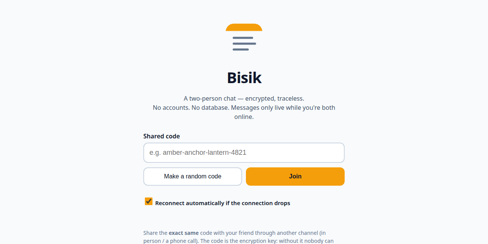

# Bisik

[](https://github.com/aqles/bisik/actions/workflows/test.yml)

A two-person chat that deliberately keeps nothing.

Bisik is a web app (installable as a PWA) for talking 1-on-1 under encryption. No accounts, no contact lists, no database. Two people enter the same code and talk. End the session and the messages end with it — no history left anywhere.

**Try it live: https://bisik.ednasalam.com** (version 0.7.0)



## Why Bisik, when Signal exists?

Most secure messengers are built around an account. Signal ties you to a phone number. Session replaces the number with a permanent ID, and holds undelivered messages on its node network for up to 14 days. SimpleX removes the ID entirely — but still asks you to install an app, creates a profile, keeps a database of your conversations on your device, and queues undelivered messages for up to 21 days.

Bisik makes the opposite trade. It is built for a conversation, not an account:

- **No identity at all.** No sign-up, no username, no permanent ID — nothing that ties one conversation to the next. The code is both the room and the key, and you can throw it away when you're done.
- **Nothing stored, anywhere.** Not "deleted after a while", not "held encrypted on our servers" — never written down in the first place. The server relays from RAM, your browser keeps no chat database, and a message to an offline friend is discarded instead of sitting in a queue for days.
- **Nothing to install.** No app store, no download record, no trace that you ever used it. Open the page, enter the code, talk. If you do install it, the icon looks like a plain notes app.
- **Small enough to verify.** One server file, one dependency, no framework. The entire codebase can be read in a single sitting — the strongest privacy claims are the ones you can check yourself.

Other messengers delete your messages. Bisik never stored them.

## How to use it

1. Open Bisik and make a random code, or type your own (at least 8 characters).
2. Share that code with your friend through another channel — in person, on a call, on paper. The code is the encryption key, so don't spread it around.
3. Your friend opens Bisik and enters the exact same code — exact means exact, capitals are different characters.
4. Talk as usual. Text and images (up to 5 MB) both work.

There's a 6-character room fingerprint at the top of the chat screen. Compare it with your friend's — if they match, you're really using the same code.

## Features

- **Forward secrecy** — every connection negotiates a fresh ephemeral ECDH session key (the exchange itself is authenticated by the code), so recorded traffic stays sealed even if the code leaks later.
- **Text + images** up to 5 MB, all encrypted in the browser before being sent. Images are re-encoded in the browser first, stripping EXIF metadata (GPS, device info).
- **Automatic reconnect** when the connection drops mid-chat (can be switched off), plus a manual "Reconnect" button that rejoins the same room without reloading the page — the on-screen history survives.
- **Privacy, Terms, and Security pages** inside the app, written plainly: what is stored (nothing), what the hosting provider can still see (your IP address), and where the protection ends.
- **Two languages** — English and Bahasa Indonesia, covering the whole app including the Privacy, Terms, and Security pages. The language follows your device; a manual switch lasts only for the session, because the language preference is not stored either.
- **Server-side limits**: max 2 people per room, caps on total connections and on every frame type (30/second per connection — messages, joins, key exchanges, and receipts alike), standard security headers, and WebSocket connections from other websites are refused.
- **Installable as a PWA** with a generic notes-style icon — deliberately not chat-looking.

## Why it needs no database

When you enter a code, your browser derives two things from it:

- **The room id** — derived by the same PBKDF2 process (not a fast hash), this is the only thing sent to the server, just to pair up the two browsers using the same code. A room holds at most 2 people. Because the derivation is expensive to compute, the room id can't be used to grind through possible codes offline.
- **The code key** — derived together with the room id in a single PBKDF2 run (600,000 iterations), and it never leaves the browser. It doesn't encrypt messages itself: it authenticates an ephemeral ECDH key exchange between the two browsers, and the resulting session key (AES-GCM 256-bit) encrypts every message and image. The session key exists only in the two pages' memory — end the session or reconnect, and a new one is negotiated.

The relay server in the middle only forwards the resulting random-looking encrypted text from RAM. It writes nothing to disk, logs no message contents, and never queues anything: if your friend is offline, your message is discarded immediately and you're told so. Every message you send carries a delivery mark — ✓ sent, ✓✓ delivered once your friend's app has actually shown it, or ✕ not delivered — so you're never left guessing whether something arrived. Chat history exists only in the memory of the open page — refresh the page and it's gone.

## The limits, stated plainly

- **If your friend is offline, the message is gone.** That's a chosen consequence, not a bug. There is no "it'll send when they're back".
- **Once a session ends, it can't be reopened.** No backups, no recovery.
- **Bisik is only as strong as its code.** A short or guessable code (a birthday, "secret123") can be tried by others. Use the built-in random code or a long custom one.
- **The code still decides who gets in.** Forward secrecy protects past sessions, not a live one: anyone who learns the code while you're talking could try to join (you'd see them arrive — a room holds at most two). Still use a fresh code per conversation.
- Bisik protects messages in transit and on the server. It can't help if your own device is already compromised, or if the person you're talking to photographs the screen.

## Run it yourself

Needs Node.js 20+.

```bash
npm install
npm start        # http://localhost:3000
npm test         # end-to-end suite (22 checks)
```

The test suite uses the exact same crypto module the browser uses, against a real server: same code can chat, only ciphertext crosses the server, a different code receives nothing — not even the key exchange, an offline recipient's message is dropped, reconnect works after a hard drop and never counts your own reconnecting tab as a second person, a 1 MB image arrives intact, message flooding is cut at the cap, delivery receipts (acks) are relayed and a dropped message names exactly which one died, connections from other websites are refused, and forward secrecy holds both ways: the code alone can't open recorded traffic, and one session's key can't open the next session.

This single Node process serves the app files and the WebSocket relay together, so deployment only needs one place that can run a long-lived Node process (a VPS, Fly.io, Render, …). The instance at https://bisik.ednasalam.com runs on Render; `render.yaml` in this repo is its configuration. In production, run it behind HTTPS — WebCrypto and PWAs only work in secure contexts (HTTPS or localhost).

## What's in the repo

- `server.js` — the static server + WebSocket relay. Deliberately small; please read it end-to-end before trusting it.
- `public/` — the web app (plain HTML/CSS/JS, no framework, no build step), including `crypto.js` (all the encryption, shared by the app and the tests) and the `privacy.html`, `terms.html`, `security.html` pages.
- `test/e2e.mjs` — the end-to-end tests against a real server.

## License

GNU AGPL-3.0 — see [LICENSE](LICENSE). In plain words: you can use, study,
modify, and run Bisik, including for other people as a service — but if you
run a modified version for others, you must publish your modified source
under this same license. Closing it up and selling it as-is is not allowed.

Releases up to and including v0.4.5 were published under the MIT License;
those copies stay MIT, as MIT grants can't be taken back. Everything from
this commit onward is AGPL-3.0.
